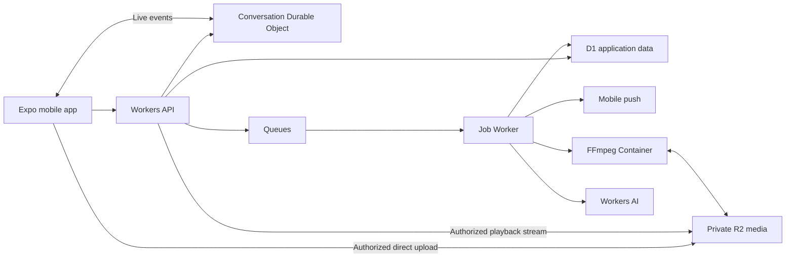

# Genoa

Private video messaging · Website: [talkgenoa.com](https://talkgenoa.com)

Architecture and delivery plan · September 16, 2026

> Original planning record. The later requests for native Android and native iOS supersede the Expo recommendation below. The implemented architecture is Kotlin/Compose and SwiftUI/AVFoundation clients with Workers/D1/R2, Android FCM and iOS APNs support, and native media. See [the current architecture](docs/ARCHITECTURE.md) and [verified feature status](docs/FEATURES.md).

Build a private video messenger for individuals and small groups. Use React Native with Expo for iPhone and Android, a TypeScript/Hono API on Cloudflare Workers, D1 for application data, and private R2 buckets for media. Keep one backend codebase, with separate API and background-job entry points. Add Durable Objects for live events and Cloudflare Containers only where actual video processing is required.

This recommendation assumes an invite-only beta for roughly 20–100 people, with all features included and no billing initially. The first beta delivers recorded messages; full parity includes watching while someone records. These are separate milestones, not equivalent experiences. A public launch and subscription system are later product decisions.

**Product scope**

Use four main screens: conversations, conversation/player, recorder, and settings. Put bookmarks, reminders, and private notes inside the relevant conversation. The core interaction is open a conversation, watch, and record a reply.

The feature inventory below combines Marco Polo’s [Plus comparison](https://www.marcopolo.me/plus/), [detailed feature list](https://support.marcopolo.me/article/202-welcome-to-marco-polo-plus), [AI feature FAQ](https://support.marcopolo.me/article/330-transcripts-summaries-and-closed-captioning-faq), and [reminders documentation](https://support.marcopolo.me/article/140-how-do-i-set-a-reminder-for-a-polo). Captions are currently free there; transcripts and summaries are paid. Public documentation can differ by platform, so validate exact parity on devices before making a parity claim.

| Capability | Planned behavior | Milestone |
|---|---|---|
| Direct and group conversations | Invite links, member management, ordered history, watched status, notification controls | 1 |
| Video messages | Record, upload reliably, play, seek, resume, reply, delete | 1 |
| Faster playback | 1×, 1.5×, 2×, 2.5×, 3× with pitch correction where supported | 2 |
| Background listening | Continue with screen locked; lock-screen controls and interruption recovery | 2 |
| HD and saving | Target 1080p capture, 720p fallback; save/export and optional auto-save of own recordings | 2 |
| Photos, imported video, voice messages | Shared message timeline and attachment handling | 2 |
| Emoji, text, and video reactions | Custom and animated emoji reactions; replies attached to a message | 2 |
| Bookmarks and forwarding | Personal bookmarks; forwarding creates a separately authorized destination message | 2 |
| Scratchpad | Private notes visible while watching and recording a response | 2 |
| Favorites and reminders | Favorite conversations; scheduled push and optional email reminders | 2 |
| Urgent notes | Prominent note and push, subject to recipient mute settings and delivery availability | 2 |
| Retained history | No automatic age-based expiry of published messages; explicit deletion supported | 1 |
| Captions, transcripts, summaries | Timestamped captions, readable transcripts, summaries generated on demand | 3 |
| Watch during recording | Join an in-progress message; live text and reactions; replay afterward | 4 |
| Plus passes / family plans | Everyone receives the features in beta; gifted entitlements and shared plans only if paid tiers are introduced | Optional commercial release |

The publisher’s [App Store listing](https://apps.apple.com/qa/app/marco-polo-video-messenger/id912561374) also identifies animated emojis as premium. It lists Sharecast under free features; broadcast-style conversations can be a later expansion beyond this direct/group messaging scope.

Long recordings remain a design requirement. Use resumable uploads and bounded processing chunks. Beta resource limits must be visible, configurable, and measured; do not advertise unlimited duration or storage while imposing undisclosed caps. No arbitrary short message limit belongs in the final parity target.

**Chosen stack**

| Layer | Choice | Why it fits |
|---|---|---|
| Mobile | React Native + Expo development builds + TypeScript | Shared app with access to native media and background capabilities |
| Local state | SQLite outbox/cache and secure OS storage for sessions | Survives interrupted uploads and app restarts |
| API | Hono on Cloudflare Workers; REST with shared validation schemas | Small deployment surface and direct Cloudflare bindings |
| Database | Cloudflare D1, SQL migrations, Drizzle | Straightforward relational model for users, groups, messages, and permissions |
| Identity | Better Auth on Workers/D1; Apple and Google sign-in | Existing authentication implementation, without an SMS dependency |
| Media | Private Cloudflare R2 Standard storage | Required storage platform; storage and request billing with no R2 internet egress charge |
| Background jobs | Cloudflare Queues + consumer Worker; scheduled repair/cleanup | Retry push delivery, media jobs, and deletion independently of requests |
| Live events | One hibernating Durable Object per active conversation | Recording presence, live text/reactions, and new-message signals |
| Media processing | On-demand FFmpeg in Cloudflare Containers | Normalize imports, extract audio, create thumbnails and playback renditions |
| AI | Cloudflare Workers AI | Transcription and text summaries without moving the backend off Cloudflare |
| Push | Expo Push Service initially, delivering through APNs/FCM | Small integration surface; monitor receipts and remove invalid device tokens |
| Optional web surface | Workers static assets | Invite landing pages and a small administration page |

Hono has an official [Workers integration](https://hono.dev/docs/getting-started/cloudflare-workers). Better Auth documents [D1 support](https://better-auth.com/docs/adapters/other-relational-databases) and an [Expo integration](https://better-auth.com/docs/integrations/expo). Confirm the selected versions work together during milestone 0. Third-party identity and mobile push are external services; application logic, stored media, and application data remain on Cloudflare.

The architecture starts as a modular monolith. No separate microservices, Redis, Kubernetes, or general-purpose server are needed. D1 is the authoritative source for messages and permissions; Durable Objects distribute live events, not a second copy of the message database. Reconnecting clients fetch missed changes from D1-backed endpoints. Before live events arrive in milestone 2, refresh on foreground/push and poll the open conversation briefly while active.

**Video upload and playback**

1. Record a compatible H.264/AAC video locally. Persist the file and an outbox entry before starting upload; a temporary camera cache file is not sufficient.
2. Request an upload session. The API checks identity, membership, quotas, and expected media type, then assigns the object key. Use presigned direct uploads to R2, including multipart upload for large files. The phone never receives bucket credentials.
3. Retry individual failed parts and persist progress. Finalization verifies ownership, object existence, actual size, and upload state. Never trust a client’s claim that upload finished.
4. Inspect media before publication. During the controlled capture beta, keep processing minimal; add container-based inspection/normalization for imported formats. Invalid or oversized media stays unpublished and is cleaned up.
5. Commit the published message and a pending-event/outbox record together in D1. A dispatcher sends push, live events, and processing jobs. A scheduled repair pass handles failures between database commit and queue submission. Message and job IDs make retries safe.
6. Playback requests pass through the media Worker, which verifies current conversation access and streams R2 bytes using HTTP Range responses. Avoid loading complete files into Worker memory. Authorize every request before any internal cache lookup; do not expose a public bucket or publicly cache private responses.

Use immutable published media keys. Keep staging upload keys separate so a still-valid upload URL cannot overwrite published content. Set lifecycle cleanup for abandoned uploads and temporary derivatives, never for published media without an explicit retention decision.

Direct upload avoids routing full videos through the API. Workers have [request-size and memory limits](https://developers.cloudflare.com/workers/platform/limits/). R2 [presigned URLs](https://developers.cloudflare.com/r2/api/s3/presigned-urls/) use the S3 endpoint and do not work on custom domains; the custom playback domain uses our Worker and R2 binding instead.

Start playback with progressive MP4 and validate fast-start layout and seeking on real devices. R2 stores files; it does not automatically encode video or create adaptive streams. Use [Cloudflare Containers](https://developers.cloudflare.com/containers/) for FFmpeg when processing is needed, with explicit concurrency, CPU, duration, and storage limits. Long jobs must be resumable or chunked and tracked persistently; queue receipt alone is not job completion.

Cloudflare Stream is a possible future managed-video alternative, but is not part of the selected design: this plan keeps media and playback assets in R2. If custom live media work becomes too expensive, compare Stream against the R2 requirement before changing architecture.

**Watching during recording**

This is the largest implementation risk. A recording indicator or a WebSocket does not provide live video.

Prototype a native capture module that emits correctly timestamped fragmented MP4 segments with keyframes, initialization data, and consistent codecs. Upload completed segments to R2, then expose an authenticated HLS playlist through Workers. A conversation Durable Object coordinates the active recording and publishes segment-available events. Target roughly 3–8 seconds behind the sender on a good connection; this is a design target to validate, not a platform guarantee.

The receiver plays uploaded segments while recording continues. Finalization closes the playlist for replay and schedules an exportable MP4. Define behavior for missing segments, network loss, sender cancellation, app termination, and multiple simultaneous senders. Track live sessions by message ID within the conversation.

Expo’s basic [camera recording API](https://docs.expo.dev/versions/latest/sdk/camera/) returns a completed recording; do not assume it provides the incremental output this requires. Keep Expo for the app and use native modules in development builds for this path. Prove seamless capture and live playback early, before committing to a full-parity delivery date. [Durable Object WebSocket hibernation](https://developers.cloudflare.com/durable-objects/best-practices/websockets/) reduces idle connection costs, but video bytes travel through R2/HTTP, not chat WebSockets.

**Data and access model**

Core records: users, auth accounts/sessions, devices, conversations, memberships, invitations, messages, media assets, upload sessions, reactions, watch progress, bookmarks, private notes, reminders, transcripts, job records, and an event outbox. Messages have a type, conversation ID, author ID, reply target, stable ordering value, and lifecycle state such as uploading, processing, ready, failed, or deleted.

Index conversation history by conversation and ordering value. Paginate using cursors. Update watch progress periodically and on pause/exit rather than on every playback tick. Store long transcript and caption files in R2, with status and pointers in D1.

Every read, write, upload, playback, forwarding, and live subscription checks membership. Private notes belong only to their author. New group members see history from their join point by default; removals revoke subsequent access. Forwarding creates a destination-owned media copy with its own permissions and deletion lifecycle. Explain to the sender that deleting the original cannot recall previously exported or forwarded copies.

Server access to media is needed for this processing design. It provides transport encryption, storage protection, and application authorization; it is not end-to-end encrypted. AI processing is opt-in for the beta, with author-controlled consent, private outputs, and deletion of derivatives when the source is deleted. Avoid message content in push previews by default.

Start with a single D1 database. Its current paid-plan [maximum is 10 GB per database](https://developers.cloudflare.com/d1/platform/limits/); monitor size and write latency and review partitioning before reaching that boundary. Keep binary media out of SQL. Use primary-consistent reads for authorization; do not add eventually consistent permission caching.

Use a transactional outbox and idempotent consumers because [Queues delivery is at least once](https://developers.cloudflare.com/queues/reference/delivery-guarantees/). Include retry limits, dead-letter handling, expired-upload cleanup, and tombstones so delayed processing cannot restore deleted messages. Back up metadata and run a restore exercise before beta expansion.

**Captions and summaries**

Extract audio in the media job, split long recordings into bounded chunks, and transcribe through [Workers AI Whisper Large v3 Turbo](https://developers.cloudflare.com/workers-ai/models/whisper-large-v3-turbo/). Preserve timing offsets when joining results, and create a timestamped caption file. Summarize the transcript on demand with a currently supported Workers AI text model; choose its exact version after checking quality, availability, and cost in milestone 3.

Media becomes playable independently of AI completion. Failed transcription must not block delivery. Summaries link back to the message and remain clearly machine-generated. Deletion and consent changes cancel pending work and prevent publishing stale results.

**Delivery sequence and acceptance gates**

| Milestone | Work | Exit condition |
|---|---|---|
| 0 — Prove media and platform fit | Expo/Workers skeleton, authentication integration, private R2 upload/playback, background playback test, short native live-capture spike | Two physical devices exchange a clip; seeking and lock-screen playback work; live approach has measured feasibility |
| 1 — Useful private beta | Identity, invitations, direct/group chats, recorded video, upload outbox, push, history, watched status, deletion, basic blocking/reporting | No lost draft after app restart; retry creates one message; nonmembers cannot retrieve media |
| 2 — Everyday premium features | All milestone-2 feature rows; import processing; live events; reminder scheduling | Physical iOS/Android tests cover speed, background audio, imports, forwards, reactions, and reminder delivery |
| 3 — AI conveniences | Captions, transcripts, on-demand summaries, consent controls | Long recordings maintain caption timing; disabled AI skips processing; deletion removes derived outputs |
| 4 — Full messaging parity | Segmented live recording/playback, live text/reactions, reconnect/recovery, completed replay/export | A recipient joins mid-recording, reacts, reconnects, and replays the completed message without gaps |
| 5 — Wider release | Accessibility, account export/deletion, recovery, cost/load testing, abuse handling, app-store preparation | Closed beta is stable across real devices and weak connections; recovery and access-control tests pass |

For one experienced full-time engineer, use approximately 4–6 weeks for a useful recorded-message beta and 10–16+ weeks for polished parity as an initial planning estimate. Native live capture is the main uncertainty; revise these estimates after milestone 0. App-store review and account setup can add calendar time.

Maintain a small monorepo: `apps/mobile`, `apps/api`, `packages/contracts`, and `packages/db`; add `apps/media` when the container is needed. Use separate staging and production Cloudflare resources. Prioritize tests for authorization, duplicate uploads/jobs, deletion races, interrupted media, and real-device background behavior.

**Operating cost model**

[R2 Standard pricing](https://developers.cloudflare.com/r2/pricing/) is currently $0.015/GB-month, $4.50/million Class A operations, and $0.36/million Class B operations, with no R2 internet egress charge. The [Workers paid plan](https://developers.cloudflare.com/workers/platform/pricing/) starts at $5/month. D1, Durable Objects, Queues, Containers, and AI have their own usage charges.

Illustration, not a quote: at an assumed combined audio/video bitrate of 2 Mbps, a minute uses about 15 MB. With 100 active users each recording 10 minutes daily, 30 days adds about 450 GB. That retained footprint costs about $6.75 per full month once stored; retaining 12 such months produces roughly 5.4 TB and $81/month in storage alone. Actual first-month billing depends on average storage over time. HD bitrate, alternate renditions, thumbnails, audio, forwarding copies, and backups increase these figures.

At the currently listed [Whisper Turbo price](https://developers.cloudflare.com/workers-ai/platform/pricing/) of $0.0005/audio minute, transcribing those 30,000 monthly minutes adds roughly $15 before allowances and retries. Summaries, media processing, and request charges are additional. Measure cost per uploaded minute and retained GB during beta, and set usage alerts. Zero egress fees do not mean the entire app is free to run.

The first implementation should prove this complete path: sign in, invite someone, record, resume an interrupted upload, publish once, receive a push, and play privately with the screen locked. That validates the architecture before investing in the rest of the interface.
