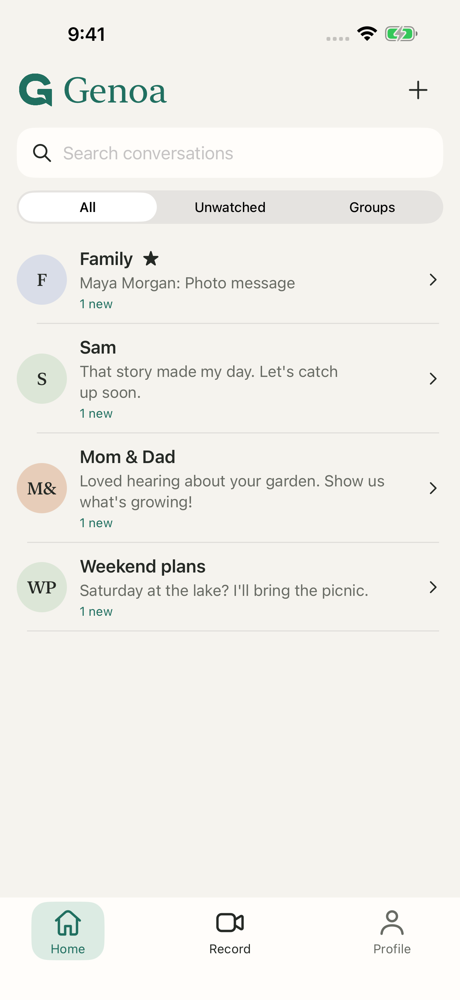
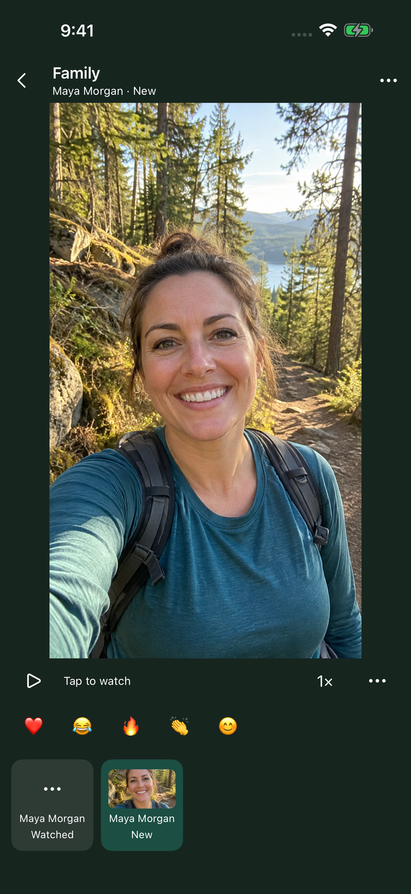
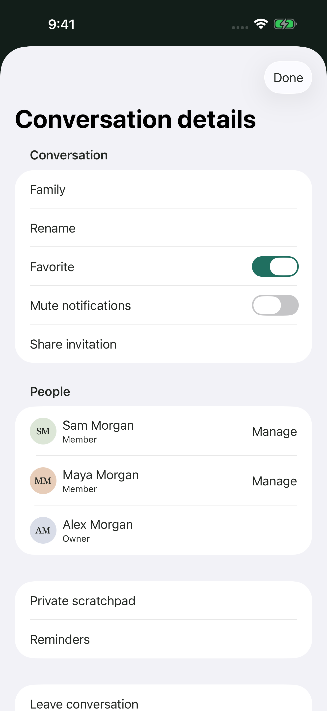
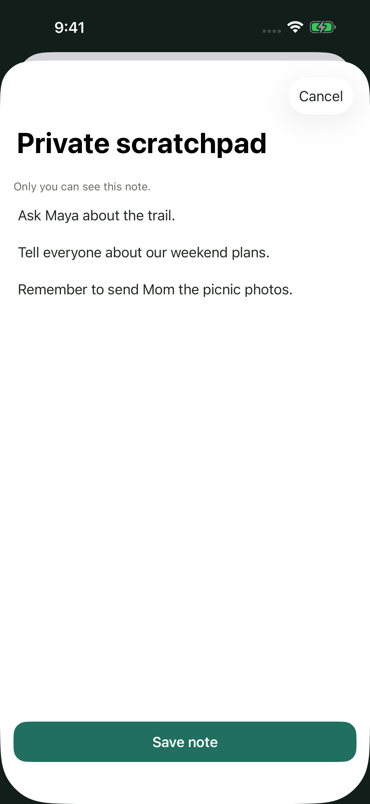

<p align="center">
  <picture>
    <source media="(prefers-color-scheme: dark)" srcset="assets/brand/genoa/png/genoa-logo-horizontal-ivory@2x.png">
    
  </picture>
</p>

<p align="center">
  Private video messaging for families and small groups.<br>
  Record a message, send it, and watch or reply whenever it suits you.
</p>

<p align="center">
  <a href="https://github.com/i-jared/genoa/actions/workflows/ci.yml"></a>
  <a href="LICENSE"></a>
</p>

<p align="center">
  
  
  
  
</p>

Genoa is a native Android and iOS app with a Cloudflare backend. Its core path is simple: find a conversation, watch what's new, record a reply, and know for certain whether it sent. Everything else stays out of the way.

- **Video, voice and photos**, recorded in the app and sent only when you choose.
- **Deliveries that survive real life.** Drafts are saved before uploading, and uploads resume after restarts and dropped connections.
- **Watch at your own pace.** Resume where you left off, change speed, listen with the screen off, and see what's new at a glance.
- **Live sharing, only with explicit consent.** Others can watch while you record, and there's a replay afterwards.
- **Replies and timed reactions** that stay attached to their message.
- **Bookmarks, private notes, reminders and forwarding**, each in context.
- **Safety.** Block and report people, with an admin console for moderation.
- **Your data.** Export or delete your account from the app.

Media is private: the server authorizes every request, including each byte range and live segment. Messages are **not** end-to-end encrypted. Genoa is beta software; see [feature status](docs/FEATURES.md) for what is verified and what still blocks a public release.

## Repository

| Directory | Contents |
|---|---|
| [`android/`](android) | Kotlin and Jetpack Compose app |
| [`ios/`](ios) | SwiftUI and AVFoundation app ([setup](ios/README.md)) |
| [`backend/`](backend) | Cloudflare Worker (Hono, D1, R2, Queues, Durable Objects), migrations and tests |
| [`admin/`](admin) | Moderation and operations console, Next.js on Vercel ([setup](admin/README.md)) |
| [`docs/`](docs) | [Architecture](docs/ARCHITECTURE.md), [design](docs/DESIGN.md), [operations](docs/OPERATIONS.md), [feature status](docs/FEATURES.md) |
| [`scripts/`](scripts) | Release builds and the backup/restore drill |
| [`store/`](store) | Store listing copy and screenshots |
| [`assets/`](assets) | Brand artwork and font license |

## Getting started

Requirements: Node 22+, JDK 17+ (Android Studio's bundled JDK works), Android SDK 36, and Xcode 26 for iOS.

### Backend

```sh
cd backend
npm ci
cp .dev.vars.example .dev.vars   # set BETTER_AUTH_SECRET to 32+ random characters
npm run migrate:local
npm run dev                      # http://localhost:8787
```

Development needs no external services. Emails (for example password resets) are written to a local `dev_emails` table instead of being sent.

### Android

Add a Firebase client configuration at `android/app/google-services.json` for the `app.genoa` package. It isn't committed; any Firebase project works for local builds. Then open `android/` in Android Studio, or run:

```sh
./scripts/release/android.sh --debug   # builds, tests and lints; writes dist/android/Genoa-debug.apk
```

In the app, set **Server connection** to `http://10.0.2.2:8787` to use the local backend from the emulator.

### iOS

Open `ios/Genoa.xcodeproj` in Xcode and run the **Genoa** scheme on an iOS 17+ simulator. The project is generated from `ios/project.yml` with [XcodeGen](https://github.com/yonaskolb/XcodeGen). See [iOS setup](ios/README.md) for signing, push notifications and the isolated test server.

### Admin console

```sh
cd admin
npm ci
cp .env.example .env.local   # then set SESSION_SECRET (openssl rand -base64 48)
npm run dev
```

Grant access by adding your user to the `admins` table; [admin/README.md](admin/README.md) has the command.

## Testing

```sh
cd backend && npm run check && npm test          # needs `npm run dev` running
cd admin && npm run typecheck && npm run lint && npm test && npm run build
cd android && ./gradlew :app:testDebugUnitTest :app:lintDebug
```

The backend suites create their own accounts against the local Worker. They cover authorization, retries, interrupted uploads, deletion races, moderation and account recovery. For iOS, start `./ios/scripts/test-server.sh`, then run the `GenoaTests` target. Android instrumentation tests run on an emulator; see the test classes for the local servers they expect. Never point tests at a production database or a personal device.

[CI](.github/workflows/ci.yml) runs the backend, admin, Android and iOS checks, plus a secret scan, on every push and pull request.

## Deployment

`backend/wrangler.production.jsonc` describes the hosted Genoa deployment. For your own, create separate D1, R2, Queue and Durable Object resources, update the configuration, then:

```sh
cd backend
npm run migrate:production
npm run deploy
```

Set secrets with `npx wrangler secret put`, never in tracked files. [Operations](docs/OPERATIONS.md) lists every secret and variable. It also covers the admin console, alerts, failed-job triage and backups. Signed app releases use `scripts/release/android.sh` and `scripts/release/ios.sh`; see [store/README.md](store/README.md).

## Contributing

Read [AGENTS.md](AGENTS.md) for the engineering and product guidelines, the [product plan](PLAN.md), and the [architecture](docs/ARCHITECTURE.md). Android UI follows the [design specification](docs/DESIGN.md). Keep changes focused and run the relevant checks. Update [feature status](docs/FEATURES.md) when verification changes.

## License

[MIT](LICENSE). The bundled Newsreader font is licensed under the [SIL Open Font License](assets/brand/genoa/licenses/Newsreader-OFL.txt).
