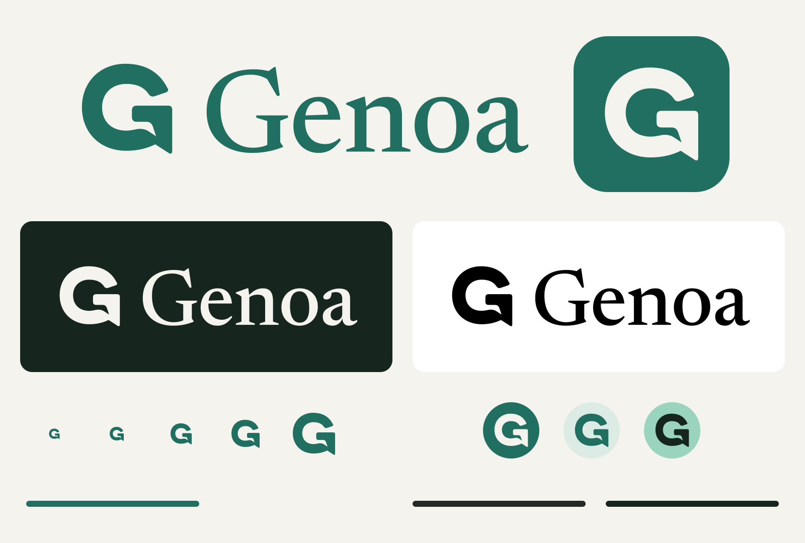

# Genoa identity kit

Version 1.0.0 · September 16, 2026



Genoa's mark is a capital **G** drawn as an open conversation bubble. Its short reply tail and generous opening remain recognizable at small sizes. The Newsreader serif wordmark brings the warmth of a personal letter to the app's existing teal and ivory palette.

## Choose an asset

| Use | Files |
|---|---|
| Primary logo | `svg/genoa-logo-horizontal-teal.svg` |
| Dark background | `svg/genoa-logo-horizontal-ivory.svg` |
| Compact vertical placement | `svg/genoa-logo-stacked-*.svg` |
| Wordmark only | `svg/genoa-wordmark-*.svg` |
| Symbol only | `svg/genoa-mark-*.svg` |
| Transparent raster artwork | `png/` — all four arrangements, five colors, 1×/2×/4× |
| Android | `android/res/` — adaptive, round, themed, notification, and legacy assets |
| Play Store icon | `store/google-play-icon-512.png` |
| Play Store feature graphic | `store/google-play-feature-1024x500.png` |
| High-resolution square icon | `store/app-icon-1024.png` |
| Browser / installed web app | `web/` — SVG and ICO favicons, 180/192/512 PNGs, maskable icon and manifest |
| Link preview | `social/open-graph-1200x630.png` |
| Social avatar | `social/avatar-1024.png` |
| Review artwork | `preview/brand-board.png` |

SVG artwork contains outlined paths, with no font installation, linked image, script, or external stylesheet required. Transparent PNGs preserve alpha. Store icon files have a full square background; the receiving platform applies corner masks. Feature and social graphics are opaque RGB PNGs. The 1024 square is also a useful source for future platform exports; this kit does not claim an iOS integration.

## Use the identity consistently

- Use teal on ivory or white, and ivory/white on dark teal. True black and white versions are supplied for one-color reproduction.
- Keep clear space of at least one quarter of the visible symbol's height around the logo. A standalone wordmark needs at least half its capital height of clear space. The SVG canvas padding is not the full required clear space.
- Use the standalone symbol from 24 px. The supplied 16 px favicon is the small browser exception. Use the horizontal logo from 160 px wide and standalone wordmark from 100 px wide. At smaller sizes, use the symbol.
- Preserve proportions, curve geometry, word spacing and color. Do not add strokes, shadows, gradients, rotation, or an extra play/camera symbol. Do not treat the symbol as a recording-state indicator.
- Use normal text for scalable page titles and welcome copy. The fixed outlined wordmark is brand artwork, not a replacement for accessible interface text.
- On the web, use `alt="Genoa"` for a logo that names the app; use empty alt text beside equivalent visible text. Label a logo link by its destination. In Android, decorative marks beside the app name have no duplicate accessibility description.
- Screen values are sRGB. Give SVG masters to a print supplier for the intended paper and output profile; no universal CMYK or spot-color match is asserted.

| Color | sRGB hex | Role |
|---|---|---|
| Teal | `#206F60` | Primary mark and icon field |
| Ivory | `#F5F3EE` | Main canvas and reverse mark |
| Ink | `#252925` | Neutral mark and surrounding copy |
| Dark | `#17251F` | Dark canvas |
| White / black | `#FFFFFF` / `#000000` | Reverse and single-color output |

Coral remains reserved for capture controls in the product and is not added to the logo.

## Android integration

The repository's manifest now uses `@mipmap/ic_launcher` and `@mipmap/ic_launcher_round`. API 26 adaptive layers use a full 108 dp background and a safely inset vector foreground; API 33 adds the matching monochrome layer for themed launchers. Legacy density PNGs are included for handoff even though this app's minimum API is 29.

Use `@drawable/genoa_notification` for small notification icons. It is white with transparency; a colored square is unsuitable for the system's alpha-mask treatment. Push, upload, and the Firebase fallback notification metadata reference this resource. Sign-in uses `@drawable/genoa_brand_mark` with the theme's primary tint. The previous camera-style launcher drawable has been retired.

Android 12+ can use the launcher icon in the default system splash. No custom splash API, extra delay, or new loading flow was added.

## Web integration

Copy `web/` to a chosen public directory. `web/head-snippet.html` assumes `/brand/`; adjust those paths to match the deployment. The example manifest assumes a root landing page and does not create a service worker or offline experience. Its icon paths resolve relative to the manifest.

Set the Open Graph image URL to the absolute hosted URL for `social/open-graph-1200x630.png` and declare width 1200 and height 630. Website deployment is separate from this asset delivery.

## Sources and reproduction

`source/brand.json` is the authoritative shape, palette, and lettering specification. The custom mark uses a single filled Bézier path. The wordmark is Newsreader Medium at optical size 32, with fixed optical spacing; all delivery artwork contains outlines.

Newsreader is distributed under the SIL Open Font License 1.1. The unmodified font and its license are included in `source/Newsreader.ttf` and `licenses/Newsreader-OFL.txt`. Source: [Google Fonts Newsreader](https://github.com/google/fonts/tree/main/ofl/newsreader). Product UI fonts remain unchanged.

`source/concept.png` is the original AI-generated exploration, and `source/concept-prompt.txt` records the exact built-in image generation prompt. The production exports are rebuilt from the vector definition, not resized from that concept image.

Install Python packages from `source/requirements.txt` in a virtual environment, and install `rsvg-convert` (librsvg). Then:

```sh
python source/build.py
python source/verify.py
```

From the repository root, to refresh the Android resources as well:

```sh
python assets/brand/genoa/source/build.py --android-res android/app/src/main/res
python assets/brand/genoa/source/verify.py
```

The builder uses only the bundled sources and local rendering tools. `asset-manifest.json` lists file sizes, PNG dimensions, and SHA-256 hashes; `SHA256SUMS.txt` is the matching checksum list. Regenerate after changing sources or documentation. The verify command checks dimensions, transparency, self-contained SVGs, safe areas, resource references, and checksums. Exact PNG bytes can differ across renderer versions; the vectors define the identity.

## Platform specifications

Checked September 16, 2026 against [Android adaptive icon guidance](https://developer.android.com/develop/ui/compose/system/icon_design_adaptive) and [Google Play preview asset specifications](https://support.google.com/googleplay/android-developer/answer/9866151?hl=en). The logo assets cover branding surfaces. A complete store submission still needs actual product screenshots, listing copy, and the app's existing release gates.
