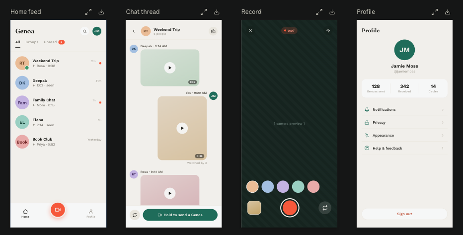
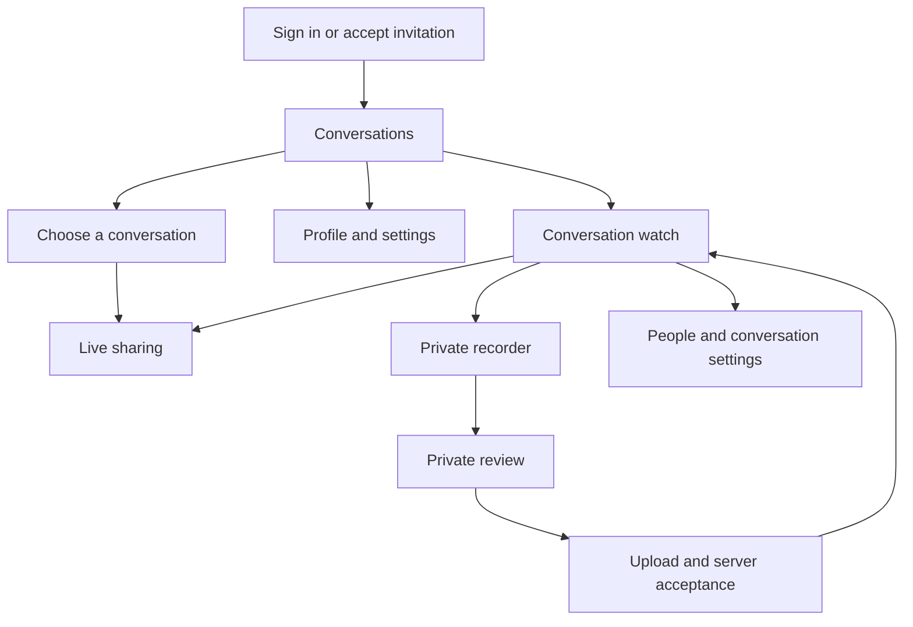
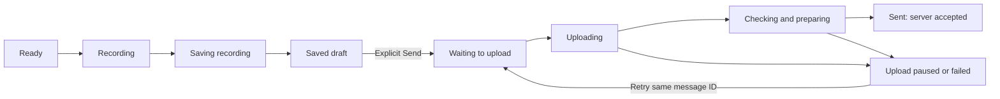

# Genoa product design specification

[Open the visual guideline sample webpage](https://genoa-design-guide.i-jared.chatgpt.site). Source: `design-guide/dist/`. The samples illustrate this specification; they do not record or send messages.

**Version:** 1.1 · **Date:** September 16, 2026  
**Status:** Implemented in the Android 0.2.0 beta. See [FEATURES.md](FEATURES.md) for verification evidence and remaining release checks; implementation does not imply every acceptance scenario has been certified.  
**Platform:** Native Android, Kotlin and Jetpack Compose  
**Website:** [talkgenoa.com](https://talkgenoa.com)

## 1. Purpose and source of truth

Genoa helps a person see a familiar face, catch up at their own pace, and send a thoughtful reply. The interface should feel personal, quiet, and dependable. A conversation with someone matters more than the number of messages exchanged.

The central experience is **find a conversation → watch a message → record a reply → review → send → see its delivery status**. Every visual and interaction decision should make that sequence easier to understand.

This specification translates the supplied four-screen reference into an implementable Android design. It covers the everyday surfaces, supporting flows, accessibility, error recovery, and component behavior. Measurements and colors below are proposed design values inspired by the reference; they are not extracted source-design tokens.

Use this document with [engineering and interaction rules](../AGENTS.md), [the architecture](ARCHITECTURE.md), and [verified feature status](FEATURES.md). The [original plan](../PLAN.md) supplies product context; its Expo recommendation has been superseded. FEATURES.md remains the source of truth for what is implemented and verified.

### Custom icons

The [Genoa identity kit](../assets/brand/genoa/README.md) defines the production logo: a filled G/conversation mark with a Newsreader serif wordmark in the existing teal and ivory palette. SVG masters, transparent PNGs, Android adaptive/themed/notification resources, web icons, store graphics, and usage rules live in `assets/brand/genoa/`. Use the supplied paths for brand artwork; keep normal scalable text for page titles. The filled logo is distinct from the outlined interface icon family below.

The visual guide uses the custom Genoa SVG set in `design-guide/dist/icons/`, with a reusable symbol sheet at `design-guide/dist/icons.svg`. Use a 24-unit grid, 1.7-unit strokes, rounded ends and joins, and consistent optical weight. Home uses a rounded roof and doorway; Record uses a compact video camera; Profile uses a head and open shoulder outline. Navigation icons render at 32 dp, control icons at 20–24 dp, and touch targets remain at least 48 dp. Use teal and a soft selection background for the active destination; keep capture coral. Icons inherit their control color and have accessible names when no visible label is present. Avoid Unicode or emoji substitutes for interface icons.

### Presentation and density

Use compact, utilitarian layouts. Give space a specific purpose: readability, grouping, a usable touch target, or stable control placement. Avoid decorative eyebrow labels, numbered presentation sections, split-color or italic heading fragments, and paired-sentence slogans. Use short descriptive headings, one text style per heading, 16 dp screen edges, 12 dp card padding, and 8 dp between related controls. Keep at least 48 dp touch targets and support enlarged text; compactness must not reduce accessibility. The guide webpage follows these presentation rules; section numbers in this technical document remain cross-reference aids.

### Reference

The image is visual inspiration. Its labels and controls are not independent instructions to implement features. The black presentation canvas, screen labels, expand icons, and download icons around the mockups do not belong inside Genoa.

### What to retain and what to adapt

| Reference element | Genoa design decision | Reason |
|---|---|---|
| Warm ivory canvas | Retain with compact spacing across conversations, thread, and profile | Keep content readable without decorative empty space |
| Small serif wordmark and headings | Retain for brand and major titles | Adds character without competing with content |
| Teal primary actions | Retain for record-entry and send actions | Establishes a consistent interaction color |
| Coral center record control | Retain for camera capture | Gives recording a distinct visual identity |
| Pastel initial avatars | Retain as deterministic identity fallbacks | Works without requiring profile photos |
| Left/right media cards | Retain with author labels and readable status | Ownership should remain clear without alignment or color alone |
| “Hold to send a Genoa” | Replace with “Record a reply,” then tap to start/stop and an explicit Send action | Prevents accidental sending and supports accessible input |
| Small unread dots | Add a count and a text status | New messages must be identifiable without color |
| Tiny metadata | Increase to the type sizes below | The supplied mockups are scaled previews, not literal touch dimensions |
| Profile statistics | Omit from the main profile | Genoa prioritizes people and account controls over engagement metrics |
| Recorder color swatches | Omit from the initial redesign | No defined filter feature or reliable processing path exists for them |
| Unexplained green avatar dot | Omit unless an actual presence feature is introduced | Avoid implying someone is online without reliable evidence |
| Profile handle | Show account email; do not invent a username system | The current account model has name and email |

## 2. Product principles and terminology

1. **People are the navigation.** Conversation names and faces lead. Feature controls stay near the message they affect.
2. **Capture starts live, and still requires consent.** The primary reply action opens live sharing. Recipients can watch only after **Start sharing live**. Private video and voice recording stay in reply options and do not send until an explicit Send.
3. **Status is a promise.** “Saved,” “Uploading,” “Processing,” and “Sent” have different meanings. Use the word that the system can substantiate.
4. **Return to where you were.** Preserve scroll position, drafts, playback position, recipient, and reply context through ordinary navigation and recoverable interruptions.
5. **A calm screen can still explain a problem.** Errors should be specific, persistent when necessary, and paired with a useful action.

Use **Genoa** for the product name and **message**, **video**, or **voice message** for content. Use **conversation** for both direct and group exchanges. Use **Profile** in navigation; its screen contains identity and settings. Use **Unwatched** for pending media and “new text message” for text; avoid calling a video “unread.” In mixed-content counts, accessible labels must state the meaning rather than assuming every item is a video.

Do not use “Circles,” “Genoas sent,” or new social terminology in the initial redesign. Write button labels as actions: “Record a reply,” “Send to Weekend Trip,” “Retry upload,” “Resume at 0:24.”

## 3. Information architecture and navigation

There are four core surfaces: Conversations, Watch, Recorder, and Profile. Search, conversation details, message actions, and recipient selection are contextual destinations.

### Primary navigation

- Conversations and Profile share a bottom bar: **Home**, a central **Record** action, and **Profile**. Use larger icons without visible labels in the bottom bar, with accessible names for Home, Record, and Profile and a clear selected state. Keep each touch target at least 48 dp. Record is an action, not a selected tab.
- Home’s center Record action opens a recipient selector first. It never silently reuses the last recipient. Selecting a conversation opens live-sharing preflight for that conversation.
- Inside a conversation, replace the global bottom bar with the watch surface: the current message full screen, a filmstrip of every message, and the reply composer. Recorder is a focused full-screen route.
- Android Back returns to the previous surface and restores its position. Recording and unsent review intercept Back as specified in section 7; normal navigation does not ask unnecessary confirmation questions.
- The toolbar profile avatar is an optional shortcut to the same Profile destination, not a separate account experience. Its accessible label is “Open profile.”

### Layout baseline

Design at a representative **390 × 844 dp** portrait viewport, then verify at 320 dp width, standard 360–430 dp phones, landscape, and large text. These are layout targets, not required device dimensions. All sizes exclude system insets unless stated.

Use 20 dp horizontal screen padding, 16 dp inside cards, and a 4 dp spacing grid. The bottom action region respects navigation and keyboard insets. Content must scroll above it; no final message or action may be hidden beneath a fixed control.

On widths of 600 dp or greater, a future two-pane Conversations/Thread arrangement is appropriate. Until implemented, center the existing single-pane flow with a 600 dp content maximum. Do not stretch a portrait video card across a tablet. Recorder/player may use the available media area while keeping controls reachable.

## 4. Visual system

### 4.1 Color tokens

| Token | Light value | Use |
|---|---|---|
| `canvas` | `#F5F3EE` | Warm page background |
| `surface` | `#FFFDFA` | Sheets, forms, raised panels |
| `surfaceMuted` | `#ECEAE3` | Quiet grouped settings and placeholders |
| `ink` | `#252925` | Primary text and dark icons |
| `inkMuted` | `#686B64` | Timestamps, descriptions, secondary text |
| `primary` | `#206F60` | Primary buttons, selected navigation, active progress |
| `onPrimary` | `#FFFFFF` | Text and icons on primary |
| `primarySoft` | `#DCEBE3` | Selected backgrounds and low-emphasis information |
| `capture` | `#FF593E` | Record affordance and recording emphasis |
| `onCapture` | `#252925` | Small labels/icons on coral when needed |
| `error` | `#B3261E` | Failure text and destructive actions |
| `controlOutline` | `#6B756D` | Necessary control boundaries on the canvas |
| `divider` | `#DFDED7` | Decorative separators only |
| `cameraBackdrop` | `#17251F` | Camera loading/fallback and player surround |

Avatar fills: apricot `#EBC19F`, sky `#ACC8E5`, lilac `#C6B3E2`, seafoam `#A2D3C5`, and rose `#E8ADAE`. Pair with `ink`; do not put white initials on a pale fill. Choose the color from a stable identity ID, so it does not change when a person edits their name. Color never indicates membership role, unread status, or online availability.

Use teal for general actions and coral for capture. Failure uses its own icon and error text; a coral dot alone never means failure. Keep most of each screen neutral.

Calculated opaque-color contrast for the proposed palette:

| Pair | Ratio | Design use |
|---|---:|---|
| Ink on canvas | 13.31:1 | Main text |
| Muted ink on canvas | 4.89:1 | Secondary text |
| White on primary teal | 5.99:1 | Button labels |
| Ink on capture coral | 4.75:1 | Labels on coral |
| White on capture coral | 3.11:1 | Do not use for small text |
| Error on canvas | 5.89:1 | Error text |
| Control outline on canvas | 4.31:1 | Essential boundaries |

These calculations cover the exact solid colors above. Recheck actual component states, opacity, overlays, photos, and gradients during implementation. Target at least 4.5:1 for ordinary text and 3:1 for essential non-text controls. The faint divider is decorative and must not be the only way to find a control.

### 4.2 Dark appearance

Honor system appearance. Use canvas `#17251F`, surface `#22332A`, primary text `#EDEFE9`, secondary text `#B2BDB4`, primary action `#9AD4BE`, and dark action text `#17251F`. Retain a restrained coral capture control. Derive and verify the remaining outline, error, pressed, and disabled tokens before shipping the dark theme.

Do not invert video or avatar imagery. The recorder’s camera preview remains live media in either appearance. Text over media uses an opaque or sufficiently dark scrim; photo brightness must not determine legibility.

### 4.3 Typography

Use the platform serif family for the Genoa wordmark and major page titles, with regular weight. Use the platform sans-serif family for names, messages, metadata, and controls. This works offline and does not require an external font service.

| Role | Size / line height | Weight | Examples |
|---|---|---|---|
| Brand/page heading | 28 / 34 sp | Regular serif | Genoa, Profile |
| Onboarding heading | 32 / 40 sp | Regular serif | Welcome to Genoa |
| Section title | 20 / 28 sp | Semibold | Conversation details |
| Conversation name | 16 / 22 sp | Semibold | Weekend Trip |
| Body | 16 / 24 sp | Regular | Message text and explanations |
| Secondary | 14 / 20 sp | Regular | Previews, helper text |
| Button | 15 / 20 sp | Semibold | Record a reply, Send |
| Metadata | 12 / 16 sp | Medium | Duration, timestamp |

Never shrink text to fit a fixed card. Allow labels to wrap, rows to grow, and layouts to stack. Use tabular numerals for timers where available so the recording badge does not change width every second. Avoid letterspacing long button labels.

### 4.4 Shape, spacing, and elevation

Spacing scale: **4, 8, 12, 16, 20, 24, 32 dp**. Use 8 dp between closely related labels, 12–16 dp between components, and 24–32 dp between sections.

| Component | Geometry |
|---|---|
| Avatar | 48 dp in lists, 32 dp beside messages, 80 dp on Profile |
| Media card | 16 dp corner radius; typically 78–84% of thread width, max 320 dp |
| Text/voice card | 16 dp corners; wraps content within the media-card maximum |
| Primary button | Minimum 52 dp height; pill shape; 20 dp horizontal padding |
| Icon button | Minimum 48 × 48 dp target; 20–24 dp glyph |
| Capture control | 72 dp target; 56 dp coral center; visible outer ring |
| Sheet | 24 dp top corners; handle optional, explicit close/back available |
| Profile group | 16 dp corners; minimum 56 dp row height |

Keep thread cards flat. Use a subtle shadow only for overlapping action surfaces, such as the center capture action, and for modal separation. Do not surround every conversation with a card or use large decorative gradients.

### 4.5 Icons and motion

Use one consistent outlined icon family with approximately 2 dp strokes. Filled icons may express selection. Mirror directional icons where the reading direction requires it. Every standalone actionable icon has a meaningful accessibility label.

Use brief 150–220 ms transitions for navigation and component changes; use a softer 220–280 ms transition for sheets. Respect reduced-motion settings. A recording indicator may pulse gently but must also show “Recording” and elapsed time. Do not pulse indefinitely for network work or use celebratory animations after sending.

## 5. Conversations / Home

### Layout and hierarchy

The top app bar contains the serif Genoa wordmark at left and Search plus the profile avatar at right. Below it, show **All**, **Groups**, and **Unwatched** filters. Remove the large promotional heading from the current returning-user screen; let the conversations start immediately below the filters.

Each conversation row contains a 48 dp avatar, conversation name, a one-line preview, last-activity time, and a clear pending-message indicator. Use a minimum 80 dp row height, 12 dp avatar-to-text gap, and a 48 dp trailing region that can expand for accessibility. A long name may use two lines before secondary details move below it.

Examples:

- **Weekend Trip** · “Rosa · Video · 0:38” · “2 new”
- **Deepak** · “Continue watching · 0:24 of 1:02”
- **Family Chat** · “Mom · Voice message · 0:15” · “1 new”
- **Elena** · “Watched”

Keep sender identity in group previews. Do not show fabricated thumbnails, durations, or read receipts while metadata loads. Pastel blocks are placeholders, not finished media artwork.

### Behavior

Selecting a row opens that conversation without automatically playing audio or video. Order by latest conversation activity with a stable tie-breaker. Preserve the user’s list position when returning. An update must not move the row being pressed during a gesture.

All includes every accessible conversation. Unwatched includes conversations with pending media; the backend/client count semantics must be made consistent before relabeling an existing mixed unread count. Groups requires a reliable group classification, rather than guessing from the title. Until that contract exists, ship All and Unwatched and omit Groups.

Search opens an inline field or dedicated search surface. Initial scope is conversation names from available conversation data. If search is only local to loaded records, say “Search loaded conversations”; do not imply full history search. Message-content search is a separate future feature.

Expose **New conversation** and **Join with invitation** as labeled actions in the recipient selector and appropriate empty states. New conversation chooses people first, then a name. The center Record button remains the dominant Home action and opens live sharing after a conversation is chosen. Existing favorite and mute controls live in conversation details; they need no new top-level tabs.

### Empty, loading, and offline states

| State | Presentation | Recovery/action |
|---|---|---|
| First use | “Your conversations start here.” with a short invitation explanation | Start a conversation; secondary Join with invitation |
| No unwatched media | “You’re all caught up.” | View all conversations |
| Search has no matches | “No conversations match ‘…’.” | Clear search |
| Initial load | A small set of row placeholders, then content or a definite error | Retry after failure |
| Refreshing with cached data | Retain rows and show quiet refresh progress | Continue browsing cached metadata |
| Offline | “You’re offline. Showing saved conversations.” | Retry connection; drafts remain accessible |
| Access revoked | Remove inaccessible content when revocation is known | Explain if the person was viewing it |

An offline list is not a promise of offline playback. Show a media-specific connection error if its bytes are unavailable locally.

## 6. Conversation and player

### 6.1 Conversation header

Show Back, the conversation avatar/name, and a member count for groups. Tapping the name opens People and conversation settings. A single overflow menu contains additional management actions. Avoid a second camera action in the header when the fixed reply composer already exposes recording.

The header can show a short recording-presence label only while that event remains current. “Someone is recording” does not mean the recording is being shared live. Expire stale presence on disconnection or timeout.

### 6.2 Watch carousel

Opening a conversation opens the watch surface. There is no chat bubble timeline. The current message fills the screen. A filmstrip along the bottom holds every message in the conversation, including text, photo, voice, and video. Tapping a thumbnail shows that message. Opening Home still does not autoplay.

Video and voice play through and then advance to the next filmstrip item. A photo stays for four seconds, then advances. A text note stays long enough to read, at least 3 seconds and at most 8 seconds, then advances. The last item stays until the person chooses another. Incoming messages do not steal the current item; the filmstrip updates in place.

Video shows the whole frame with letterboxing where needed. Voice uses a full-screen voice treatment with duration, not a decorative waveform. Photo uses the full media area. Text uses large readable type on the dark canvas.

Show the author name only when the sender changes from the previous filmstrip item. Keep a compact timestamp. Place a kebab menu and one-tap emoji bar at the bottom of the watch screen. Reactions are timed to a moment in the video and appear there on later plays. There is no reply-to-this-message control. New recordings join the filmstrip in send order.

| Viewing state | Visible treatment | Accessible description |
|---|---|---|
| New | Filmstrip thumbnail without a watched mark | “New video from Rosa, 38 seconds” |
| Partially watched | Start from the beginning | “Video from Deepak, 24 seconds in when last left” |
| Finished | No extra badge on the current message | “Watched video from Elena” |
| Unavailable/deleted | “This message is no longer available.” | “Message no longer available” |

A sender’s delivery status and the current viewer’s watch progress are separate pieces of information.

Show “Watched by 3” only if the server provides that receipt data and its meaning is defined. The current client’s own watched flag cannot establish group receipts. Do not invent this count to match the reference.

Open the watch surface at the earliest unwatched incoming item across accessible history, or the latest message when everything is caught up. Start the filmstrip at that item. Scrolling toward older messages loads earlier pages without changing the current item or snapping the strip back. Load newer pages contiguously as needed; do not skip a gap between the opening window and the newest messages.

### 6.3 Reply composer and message actions

The composer is hidden while a message plays. After the last filmstrip item ends, the media area becomes a front-camera preview. Keep past messages visible and selectable in the filmstrip, including in recording preflight; hide it only once recording begins. Center the camera action on the screen, with the plus control immediately beside it. The plus control offers private video, voice, import, and text. While a message plays, kebab, heart, laugh, fire, and the emoji picker sit in a column to the right of the speed control. Align play, elapsed/total time, and speed with the bottom emoji picker. On short landscape surfaces the reactions may share a horizontal row.

Lay out transport, seek bar, and filmstrip in sequence, accounting for their actual heights and system insets. The seek bar stays completely above the filmstrip. Use the player's decoded duration when available, preserve the thumb while dragging, and visibly reach the endpoint before advancing. Cover a new video with the camera backdrop and a compact named loading indicator until its first frame, size, and layout are ready. Use the same quiet indicator for buffering, camera startup, and preparation; upload progress reflects confirmed bytes. Failed or stalled loading offers a recovery action.

Do not attach a reply to a specific earlier message. Every send is just the next item in the filmstrip.

Creating a conversation asks for people first, then a name. People you already talk with can be added immediately; someone new still joins with an invitation.

Message overflow includes Bookmark, Remind me, Forward, Save, and permitted Delete/Report actions. Use labeled rows rather than an unexplained icon grid. The kebab opens that sheet. One-tap emojis sit below it; the extra emoji button opens the system emoji picker. Long-press is a shortcut, never the only route.

After a reaction is accepted, its emoji rises from the picker along the side of the video. Other people’s reactions appear at their recorded playback moments as compact cards near the top, showing the sender’s name and emoji. Stack up to three cards, queue bursts, and dismiss oldest first on elapsed time even while paused. Own reactions do not also appear as incoming cards. Replaying a moment may show its cards again; seeking does not flood the screen with skipped reactions. Respect reduced motion. Reactions stay on their source message at the playback time they were sent. Private notes live in a conversation/player sheet labeled **Private note · Only you can see this**. Reminders identify the source message and selected time. Forwarding shows a destination confirmation before creating a separately authorized copy; it never silently moves the original.

### 6.4 Watch playback chrome

Back returns to Home. The conversation name opens People and conversation settings. A single overflow holds conversation management. Message actions (bookmark, save, forward, delete) live in one side-menu sheet, not as a row of labeled buttons.

Start each filmstrip item from the beginning, including auto-advance to the next video. Saved position still records watch progress. Completion means playback reached the end or the person explicitly marked it watched; seeking alone must not fabricate completion.

Expose speed through one icon that opens **1×, 1.5×, 2×, 2.5×, 3×**. Default to 1×. If a speed preference is intentionally retained, show it on the speed icon and provide an easy return to 1×; never change speed silently. Captions, transcript, and summary are hidden for now. The private note stays in the conversation overflow.

Background audio continues only after user-initiated playback and is visible in media controls. Starting a recorder stops existing playback to prevent feedback. Leaving the player may keep intentional background listening active with a visible mini-player on Home/thread; pressing Pause or closing the mini-player stops it. This mini-player is a proposed addition and must be implemented with the playback service as the single playback owner.

## 7. Recorder and private review

### 7.1 Ready state

Use a full-screen camera preview with dark translucent control regions. The top region shows Close, **To: Weekend Trip**, and camera capabilities such as flash only when supported. Recipient remains visible throughout capture and review. Live preflight shows the camera preview before Start sharing live.

The bottom region contains camera flip, the coral capture control, and a labeled voice/video mode selection before recording. There is no unexplained palette, gallery thumbnail, or filter carousel. Imported media is selected deliberately from the conversation attachment menu.

Before permission has been granted, replace the camera area with a concise explanation and a permission action. Request camera/microphone access at the moment it is needed. Voice recording requires microphone access only. If camera access is declined, offer voice or text without repeatedly opening a permission prompt.

Ready-state copy: **“Tap to record. Only you can see this until you send.”** Tapping the capture control begins recording; opening the screen does not.

### 7.2 Active recording

Show **Recording · 0:07** in a persistent top-center badge, accompanied by a recording indicator. The coral circle becomes a square Stop glyph inside the same ring; the target remains in the same position. Its accessible label becomes “Stop recording.” Do not announce the timer every second to a screen reader.

Keep recipient identity visible. Lock recipient changes during recording. Disable unsupported camera switching instead of simulating it. Hide nonessential controls while retaining their layout space where needed for stability.

On Close or Back, offer **Keep recording** and **Stop and review**. Discard is available after stopping and requires deliberate confirmation. If the platform forces recording to stop, finalize what can be recovered, show the result truthfully, and explain any unsaved segment. Do not promise that an abrupt process death can always preserve an in-progress encoded file.

### 7.3 Finishing and review

After Stop, show a brief **Saving recording…** state until the local media and durable draft entry are confirmed. Only then show **Saved on this phone**. Preview does not autoplay sound.

The review screen includes the recipient, preview/play control, duration, and three clearly ranked actions: primary **Send to [conversation]**, secondary **Keep draft**, and tertiary **Discard**. If the recipient is no longer accessible, disable Send with an explanation and preserve the local draft for permitted local recovery.

Retake is optional and must not delete the existing draft until the user confirms replacement. Closing a saved review keeps the draft. Deleting a draft uses “Discard this recording?” with “Keep draft” and “Discard.” Do not call a destructive action “Cancel.”

### 7.4 Delivery state model

This is a UX state model, not a claim that every state has a dedicated enum or persistent field today. “Checking and preparing” may be brief during server finalization; do not artificially delay sending just to display every stage. Optional AI work has its own status after delivery.

| State | User-facing copy | Actions and rules |
|---|---|---|
| Saved draft | “Draft · Saved on this phone” | Preview, Send, Discard |
| Queued/offline after Send | “Waiting for a connection. Your recording is saved.” | Retry when possible; safe cancellation only if queue cancellation is implemented |
| Uploading | “Uploading · 42%” | Progress from confirmed uploaded bytes; never a fabricated timer |
| Server finalization | “Processing your message…” | Do not show Sent; reconcile after a lost response |
| Sent | “Sent · 9:20 AM” | Only after authoritative server acceptance |
| Temporary failure | “Upload paused. Your recording is saved.” | Retry using the same stable ID |
| Permanent access failure | “You can’t send to this conversation anymore.” | Keep draft, permitted Save, Discard; do not endlessly retry |
| Local save failure | “Couldn’t save this recording.” | Explain storage/access problem; offer recovery only if a usable file exists |

After Send, return to the thread with a local outgoing card that retains its identity as upload progresses. Double-tapping Send does not create a second message. Restarting the app restores the same outgoing card and status. An interrupted final response requires synchronization; it must not create a second upload or falsely report failure as definitive.

### 7.5 Live sharing

Live sharing is the default record path. The camera icon on Home and on the finished watch screen opens a preflight that already shows the front camera. The same camera icon starts sharing. Private capture remains available from the plus menu.

During live capture show **SHARING LIVE**, elapsed time, and **End live sharing**. State must be established before recipients can watch. Viewer counts are omitted unless reliable data exists. A connection interruption changes the status to **“Live connection paused”** and explains the local recording status without claiming uninterrupted sharing.

Ending live sharing stops further distribution and finalizes the replay. Do not present a private Send button afterward as though nobody had access yet. Explain that recipients may already have watched; deletion can revoke future access but cannot undo viewing or independent exported copies. Live recovery and finalization require dedicated verification beyond the ordinary recorder path.

## 8. Profile and settings

Match the reference’s restrained composition: serif **Profile** heading, centered 80 dp initial avatar, name, and account email. Remove the three-column statistics panel. The screen should make account and privacy choices easy to understand rather than encourage message volume.

Use grouped, labeled rows:

| Group | Contents | Behavior |
|---|---|---|
| Notifications | Message notifications and system permission state | Distinguish the account preference from Android permission; offer Open system settings when blocked |
| Privacy | Transcription consent, explanation of server-authorized privacy | Explain that media is processed by the server and is not end-to-end encrypted |
| Media | Save my recordings | Explain local gallery copies and permission/recovery needs |
| Appearance | System appearance initially | Add System/Light/Dark only when an explicit persisted preference is implemented |
| Account | Export account data, Delete account | Export provides a real file; deletion uses clear explicit confirmation |
| About Genoa | App version, talkgenoa.com, supported formats/limits | Open the real website address; never promise unimplemented help or recovery |

Provide Help & feedback only when it has a functioning destination. Do not expose an empty row to imitate the reference. Conversation-specific mute, members, ownership, and leaving belong in conversation details.

Sign out is a full-width low-emphasis outlined action at the end of the scroll content, clearly separated from Delete account. If uploads are pending, explain that signing out pauses account-authorized delivery and retains account-scoped drafts. Drafts must not appear to another signed-in user.

Profile is scrollable at large text sizes. Avoid pinning Sign out over the content just to reproduce the screenshot’s bottom placement.

## 9. Supporting flows and recovery

### Onboarding and invitations

The welcome screen uses the Genoa wordmark, a short purpose statement, and a single primary action appropriate to the state: Sign in or Join Genoa. The existing invitation-gated email/password flow remains. Do not show Apple, Google, username setup, or password recovery controls until their integrations exist.

Preserve an incoming conversation invitation through sign-in and show the destination before joining. Invalid, expired, and revoked invitations receive clear messages and a way back. Website identity is talkgenoa.com; current `genoa://` invitation links and the legacy compatible scheme remain supported. HTTPS invitation landing pages and verified Android App Links require separate hosting, association, and release work.

### Conversation management

Conversation details shows its name, members, invitation action, mute/favorite preferences, and available membership actions. Distinguish owner-only actions from personal settings. Confirm member removal and leaving when they revoke access. Explain required ownership transfer before an owner leaves, following the server’s actual rules.

### Failure patterns

| Trigger | Required response |
|---|---|
| Network lost while browsing | Preserve existing content; show connection status without a blocking dialog |
| Network lost while uploading | Persist draft and progress; explain retry behavior in the message card |
| Session expires | Ask the person to sign in again; keep drafts scoped to their account |
| Membership changes | Stop unauthorized playback/upload once revocation is known; remove access and explain why |
| Storage runs low | Explain before capture when detectable; stop safely and report the actual saved result |
| Unsupported import | Name accepted types: JPEG/PNG, MP4/M4A; unsupported codecs may still require rejection with a clear reason |
| Caption generation fails | Keep playback available; show Retry only when the action is actually supported and permitted |
| Message deleted during playback | Stop playback and show “This message was deleted” |
| Notification opens a missing message | Open a safe conversation/list destination and explain that the message is unavailable |

Transient confirmation may use a snackbar. Persistent upload failures, permission blocks, and unsaved-recording errors need in-place information that survives navigation. A spinner always belongs to a named operation with a path to timeout/retry or reconciliation.

## 10. Accessibility, adaptation, and interaction details

- Maintain at least 48 × 48 dp interactive targets, including small avatars that open profiles, overflow buttons, caption controls, and duration-adjacent actions.
- Verify at 200% font scale. Conversation rows, filters, settings, and buttons can grow; important labels are never clipped or replaced solely by icons.
- Use explicit state descriptions for recording, sending, partially watched, muted, bookmarked, and selected filters. Avoid duplicate announcements from decorative icons and adjacent text.
- A message’s reading order is author → time → media action → duration/viewing state → reply/reactions. Modal sheets move focus into the sheet and return it to the invoking control when dismissed.
- Announce recording start/stop, upload failure, and successful send once. Do not announce every timer tick, percentage, or incoming presence event.
- Provide buttons/menu items for actions also available through long-press, swipe, or drag. Seeking has accessible adjustable semantics. A small progress line must not be the only usable seek target.
- Haptic confirmation may accompany recording start/stop and cannot be the only feedback. Avoid unnecessary sound effects or loud completion chimes.
- Respect safe areas, gesture navigation, keyboard insets, and system contrast/text settings. Test TalkBack, switch access, large text, reduced motion, and both appearances.
- In landscape, put camera controls in a stable reachable rail or bottom region without covering the recipient/timer. Preserve recording orientation correctly; layout rotation must not restart capture.
- Verify names in long and right-to-left forms. Mirror navigation where appropriate, but preserve media orientation and chronological meaning. Display localized dates and distinguish “Today,” “Yesterday,” and older dates consistently.

## 11. Implementation map and feature gaps

The redesign should fit the existing feature organization. UI composables render explicit state and invoke ViewModel actions. Network, persistence, media ownership, and authorization stay in their existing owners. No new backend, database, or parallel state system is needed solely to restyle screens.

All file paths below are relative to the repository root. They identify starting points, not a mandate to place all new logic in those files.

| Area | Existing starting point | Design work and dependencies |
|---|---|---|
| Theme | `android/app/src/main/java/app/gather/ui/Theme.kt` | Adopt semantic palette, type scale, shapes; verify light/dark states |
| Shared components | `android/app/src/main/java/app/gather/ui/Components.kt` | Consistent avatars, labeled states, accessible buttons, row geometry |
| Home | `android/app/src/main/java/app/gather/ui/ConversationsScreen.kt` | Compact list, navigation, recipient selector, search; clarify Groups/unwatched semantics |
| Routing | `android/app/src/main/java/app/gather/MainActivity.kt` | Route-aware bottom actions and reliable Back/return behavior |
| Watch | `android/app/src/main/java/app/gather/ui/PlayerScreen.kt` | Full-screen message, filmstrip, composer, compact chrome |
| Conversation chrome | `android/app/src/main/java/app/gather/ui/ConversationChrome.kt` | Reply composer, timed emoji bar, drafts, message and conversation sheets |
| Recorder/review | `android/app/src/main/java/app/gather/ui/RecorderScreen.kt`, `DraftPreview.kt` | Recipient-first capture, stable controls, durable private review, explicit Send |
| Live | `android/app/src/main/java/app/gather/ui/LiveScreen.kt` | Distinct preflight, sharing state, interruption/replay recovery |
| Profile | `android/app/src/main/java/app/gather/ui/SettingsScreen.kt`, `AccountControls.kt` | Group existing settings, identity, sign-out and deletion separation |
| State | `android/app/src/main/java/app/gather/ui/GenoaViewModel.kt`, `data/Models.kt` | Derive screen status from persisted drafts and server truth; add missing state only where necessary |
| Delivery | `android/app/src/main/java/app/gather/data/Repository.kt`, `UploadWorker.kt`, `DraftStore.kt` | Preserve stable IDs, drafts, retry behavior, and actual server acceptance |

The `app.gather` package remains a technical compatibility identity as documented in ARCHITECTURE.md. It is not visible Genoa branding and should not be renamed as an incidental part of this visual work.

### Capability distinctions at the pre-redesign baseline

This table records the starting point for the redesign. The current implementation and verification record is in FEATURES.md.

| Category | Current baseline | Proposed work / constraint |
|---|---|---|
| Brand and website | Genoa text and website link are already in source | Apply the new visual system consistently |
| Recording and delivery | Native recording, explicit send, local drafts, WorkManager uploads exist | Audit finalizing/queued/processing state presentation; the local enum currently contains SAVED, UPLOADING, FAILED, SENT |
| Playback | Playback, position, speed, background service exist | Redesign controls; add a mini-player without creating another player owner |
| Conversation filtering | All and unwatched-style filtering exist | Search and Groups need explicit implementation and accurate data semantics |
| Media previews | Media rendering exists | Verify availability/performance of actual thumbnails; no new derivative pipeline solely for visual parity |
| Read receipts | Client message model has the viewer’s watched flag | Group “Watched by” needs a separate supported receipt contract |
| Profile | Name/email and core preferences exist | No handles, activity counters, or empty support destinations |
| Appearance | System-driven light/dark theme exists | Manual choice requires persisted preference and complete theme verification |
| Advanced media | Restricted imports, AI, and live paths exist with release gates | Filters, arbitrary transcoding, and additional presence features are outside this redesign |
| Website | talkgenoa.com is the chosen address | A website design/build and verified HTTPS links are separate deliverables |

## 12. Delivery sequence

1. **Foundations and component examples.** Apply the theme and build examples of a conversation row, media card, action bar, recorder status, and error state. Review at small width, large text, and in both appearances.
2. **Home and navigation.** Implement the compact list and recipient selection. Retain existing conversation creation/join functionality. Add only filters and search whose scope can be stated truthfully.
3. **Thread and player.** Implement message ownership, viewing states, anchored scrolling, contextual actions, and playback controls. Verify existing notes, bookmarks, reminders, reactions, forwarding, and captions remain reachable.
4. **Recorder and delivery.** Implement the private capture/review flow and explicit delivery states. Verify restart, connection loss, duplicate taps, access changes, and safe discard before calling this stage complete.
5. **Profile and supporting flows.** Group settings, align identity and invitation surfaces, and finish accessible error/recovery copy.
6. **Live and release validation.** Verify explicit consent, interrupted live sharing, final replay, physical-device capture, notifications, and background playback. Update FEATURES.md with evidence and remaining gates.

Treat each stage as a reviewable change. This document does not authorize a claim that a mockup, compiled layout, or emulator-only run proves the end-to-end experience works.

## 13. Acceptance checklist and review scenarios

### Visual review

- [ ] The four core surfaces share the warm canvas, serif heading treatment, teal action system, and restrained coral capture control.
- [ ] The conversation list is led by people and messages; no promotional heading or statistics block displaces the primary content for returning users.
- [ ] Every message identifies the sender and clearly distinguishes new, partial, finished, and delivery states.
- [ ] The recorder shows the recipient and unmistakable capture/sharing status over bright and dark camera scenes.
- [ ] Layouts survive narrow screens, long names, landscape, 200% font scale, and dark appearance without clipped controls.
- [ ] Real media replaces placeholders where available; unresolved features do not appear as dead controls.

### End-to-end review

| Scenario | Expected outcome |
|---|---|
| First-time participant | Joins/signs in, finds a conversation, plays one message, and records a reply without coaching |
| Private recording | Opening or using the recorder sends nothing until Send is explicitly selected |
| Stop, leave, restart | A successfully saved draft reappears with recipient and reply context intact |
| Send while offline | One queued outgoing message remains; reconnect resumes safely and ultimately confirms acceptance |
| Duplicate Send / lost final response | One published message; synchronization resolves uncertainty |
| Partially watched message | Returns to saved position with a readable Continue action and no unsolicited playback |
| Revoked access | Playback/upload stops when revocation is known; data remains inaccessible; local draft handling is truthful |
| Live sharing | Recipients can watch only after explicit consent; ending live stops further sharing and leads to a verified replay state |
| Incoming content while reading | No forced scroll jump or autoplay; a clear action reveals new messages |
| Sign out with pending draft | Another account cannot see the draft; the original account can recover it after signing back in |
| Permissions or low storage | No mystery spinner, false Saved state, or unusable recovery action |
| Background listening and reply | Media controls stay consistent; entering recording stops existing playback |

Run relevant Android builds and lint, backend checks for any changed contract, and meaningful lifecycle/authorization tests where behavior changes. Record physical-device and accessibility evidence separately from compilation. A new person should be able to answer **who this is for, whether recording is active, whether anyone can watch yet, and whether the message has actually sent** at every step.

## 14. Decisions fixed by this document and later choices

The proposed baseline is light and warm with system dark support, serif display headings, ordinary message terminology, tap-based capture, explicit Send, and a profile without engagement statistics. The screenshot’s hold-to-send interaction, undefined filters, online dots, and handles are not part of the baseline.

The custom logo and outlined brand lettering are defined in the Genoa identity kit. Later product choices include manual appearance selection, richer group receipts, named presence, full-history search, camera effects, and a public website experience. Each needs its own behavior and implementation decision before entering the UI. None should block the core visual redesign.
